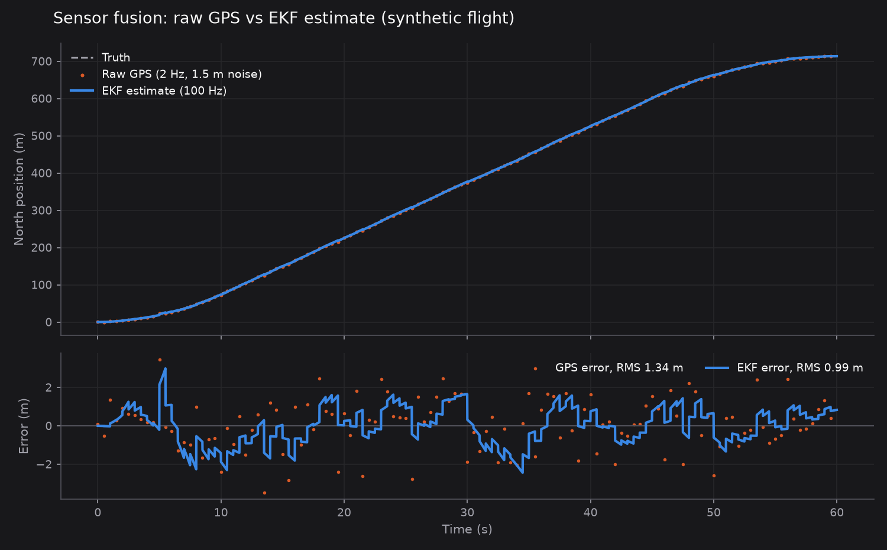
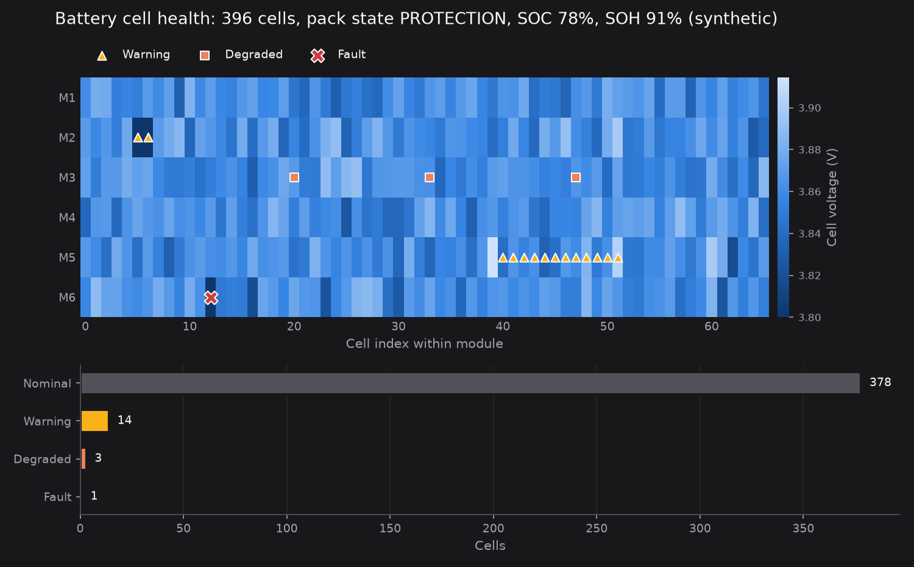
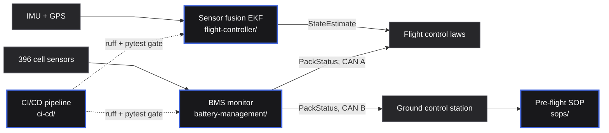

<div align="center">

# ✈️ Halcyon Aero Engineering Docs

A small, runnable engineering repository for a fictional eVTOL aircraft: sensor fusion, battery monitoring, CI/CD and SOPs.


[](LICENSE)


[Overview](#overview) ·
[What's inside](#whats-inside) ·
[Architecture](#architecture) ·
[Quickstart](#quickstart) ·
[Project layout](#project-layout) ·
[Documentation](#documentation) ·
[Limitations](#limitations)



<sub>A 60 second synthetic flight: raw 2 Hz GPS (orange) against the 100 Hz EKF estimate (blue). Regenerate with <code>make visuals</code>.</sub>

</div>

---

## Overview

Halcyon Aero is a made-up eVTOL company, and the H1 is its made-up aircraft. This repository is what
a slice of its engineering repo might look like: a 15-state error-state Extended Kalman Filter
that fuses IMU and GPS into a flight state estimate, a battery management monitor that classifies
each of the pack's 396 cells and rolls them up into a pack state for the flight computer, a
reference CI/CD pipeline with DO-178C-style gates, and a pre-flight battery SOP whose limits line
up with the code. Everything runs locally with `uv`, the tests run offline in under a second, and
the README figures come from the repository's own modules run on seeded synthetic inputs.

## What's inside

| Module | Path | What it does | Tested |
|---|---|---|---|
| Sensor fusion | [`flight-controller/sensor_fusion.py`](flight-controller/sensor_fusion.py) | 15-state error-state EKF: IMU predict, GPS position update, quaternion attitude, gyro and accel bias states, Joseph-form covariance update | [`tests/test_sensor_fusion.py`](tests/test_sensor_fusion.py) |
| Battery management | [`battery-management/bms_monitor.py`](battery-management/bms_monitor.py) | Per-cell classification (nominal, warning, degraded, fault), pack state machine, SOC from OCV, SOH from internal resistance | [`tests/test_bms_monitor.py`](tests/test_bms_monitor.py) |
| CI/CD | [`ci-cd/build-pipeline.yaml`](ci-cd/build-pipeline.yaml) | Reference GitHub Actions pipeline: ruff, pytest, HIL bench on `main`, certification artifacts on `release/*` | Lint and test jobs match `make lint` / `make test` |
| SOPs | [`sops/SOP-BMS-001-pre-flight-battery-check.md`](sops/SOP-BMS-001-pre-flight-battery-check.md) | Pre-flight battery check with acceptance ranges, self-test steps and sign-off | Document |
| Visuals | [`scripts/make_visuals.py`](scripts/make_visuals.py) | Runs both modules on seeded synthetic data and writes the PNGs in `docs/assets/` | `make visuals` |



<sub>BMS monitor on a synthetic pack: a hot spot in module 5 and two low cells raise warnings, three aged cells are degraded, one failed cell faults, and the pack drops to <code>PROTECTION</code>.</sub>

## Architecture



Blue nodes live in this repository. Gray nodes are aircraft context that is described but not
implemented. [`docs/ARCHITECTURE.md`](docs/ARCHITECTURE.md) has the detailed data-flow diagram and a
walkthrough of each module.

## Quickstart

Prerequisites: [uv](https://docs.astral.sh/uv/) and `make`. uv installs Python 3.12+ if needed.

```bash
git clone https://github.com/kumarlakshya24/aviation-engineering-docs.git
cd aviation-engineering-docs

make install   # uv sync: numpy, plus pytest, ruff and matplotlib for development
make test      # uv run pytest -q
make lint      # uv run ruff check .
make visuals   # uv run scripts/make_visuals.py, rewrites docs/assets/*.png
```

Use the modules directly:

```bash
uv run python - <<'EOF'
import sys; sys.path[:0] = ["flight-controller", "battery-management"]
from bms_monitor import BMSMonitor, CellReading

bms = BMSMonitor()
print(bms.update_cell(CellReading(0, 0, voltage=2.95, temperature=25.0,
                                  internal_resistance=22.0, cycle_count=100)).name)  # WARNING
EOF
```

Nothing calls the network or a cloud account. Cleanup is `rm -rf .venv` (or delete the clone).

## Project layout

```
aviation-engineering-docs/
├── flight-controller/
│   └── sensor_fusion.py        # 15-state error-state EKF
├── battery-management/
│   └── bms_monitor.py          # cell classification and pack status
├── ci-cd/
│   └── build-pipeline.yaml     # reference CI pipeline (not run by GitHub from here)
├── sops/
│   └── SOP-BMS-001-pre-flight-battery-check.md
├── docs/
│   ├── ARCHITECTURE.md         # detailed diagram and module walkthrough
│   └── assets/                 # generated figures
├── scripts/
│   └── make_visuals.py         # reproducible figure generation
├── tests/
│   ├── test_sensor_fusion.py
│   └── test_bms_monitor.py
├── Makefile
├── pyproject.toml
└── LICENSE
```

## Documentation

| Document | Contents |
|---|---|
| [`docs/ARCHITECTURE.md`](docs/ARCHITECTURE.md) | Data flow between flight controller, BMS and CI/CD, per-module behaviour, buses, redundancy |
| [`sops/SOP-BMS-001-pre-flight-battery-check.md`](sops/SOP-BMS-001-pre-flight-battery-check.md) | Pre-flight battery check procedure |
| [`ci-cd/build-pipeline.yaml`](ci-cd/build-pipeline.yaml) | Annotated pipeline definition |

## Limitations

- **Not flight software.** The DO-178C and DAL labels describe the fictional reference design. This
  Python is a readable reference model, not certified code, and should not be used to fly anything.
- **The EKF fuses IMU and GPS position only.** GPS velocity, barometer and magnetometer have noise
  constants but no update step. LLA to NED is a flat linearisation about (0, 0), not WGS84.
- **BMS range and time-to-empty are rough.** `get_pack_status` uses a simplified energy and power
  model. Treat `estimated_range_nm` and `time_to_empty_min` as placeholders, not predictions.
  SOC comes from voltage alone, with no coulomb counting.
- **The HIL and certification jobs are stubs.** They reference a self-hosted bench and scripts that
  are not in this repository. The pipeline sits in `ci-cd/`, so GitHub does not run it.
- **Module directories use hyphens**, so they are put on `sys.path` (pytest `pythonpath`, and in the
  visuals script) rather than imported as a package.

## License

[MIT](LICENSE). Copyright (c) 2026 Lakshya Kumar.

---

<div align="center"><sub>All data is synthetic. Halcyon Aero is fictional.</sub></div>
