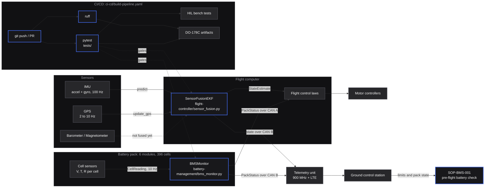
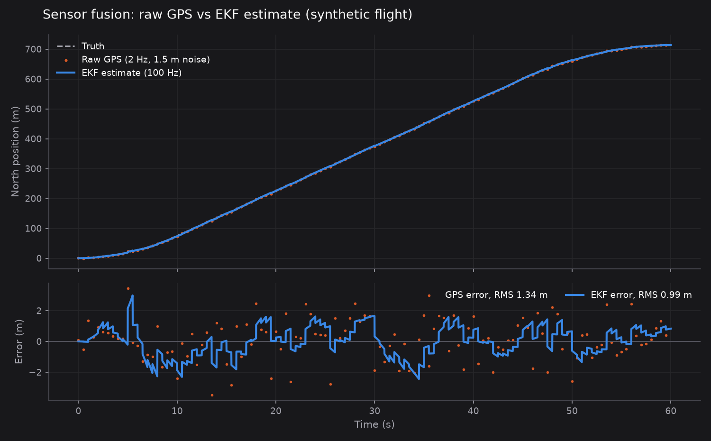
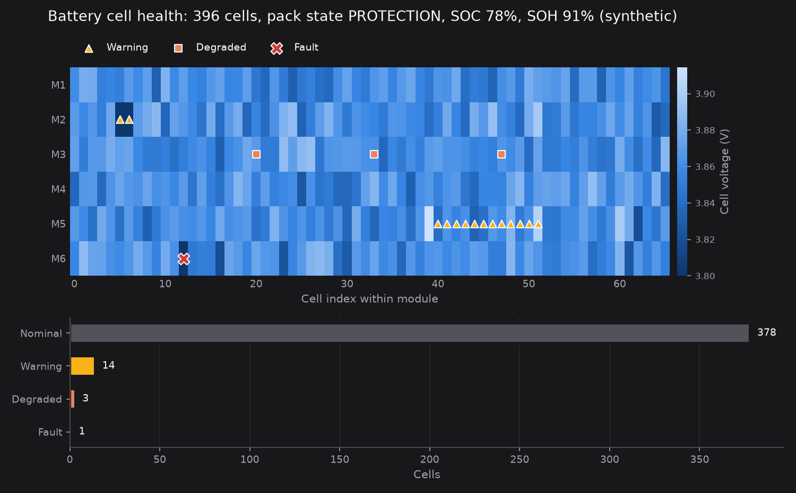

# Architecture

Halcyon Aero H1 is a fictional eVTOL aircraft. This document describes how the pieces in this
repository fit together: the flight controller's state estimator, the battery management monitor,
the CI/CD pipeline that gates both, and the SOPs that use their outputs on the ground.

Blue-outlined nodes have code or documents in this repository. Gray nodes are context: they exist in
the reference design but are not implemented here.

## Data flow

## Modules

### Flight controller: `flight-controller/sensor_fusion.py`

A 15-state error-state Extended Kalman Filter: position (NED), velocity (NED), attitude error
(rotation vector), gyro bias, and accelerometer bias.

- **`predict(reading)`** integrates bias-corrected IMU data. The accelerometer reports specific force
  in a z-down body frame, so a level aircraft at rest reads `[0, 0, -g]`. The filter rotates it to NED
  and adds gravity back. Covariance propagates with a linearised transition matrix `F` and a discrete
  process noise `Q`.
- **`update_gps(reading)`** fuses GPS position when the fix is 3D or better (`gps_quality >= 2`).
  RTK fixes (`gps_quality == 3`) use a measurement noise 100x tighter. The covariance update uses the
  Joseph form for numerical stability.
- **Simplifications**: LLA to NED is a flat linearisation about (0, 0). GPS velocity, barometer and
  magnetometer have noise constants but no update step yet.

### Battery management: `battery-management/bms_monitor.py`

Classifies every cell and aggregates pack status for the flight computer.

| Cell state | Rule (HA-BMS-SPEC-2024-003 Table 3.1) |
|---|---|
| `FAULT` | V <= 2.80 or V >= 4.20, or T <= -20 degC or T >= 60 degC. Logged once per cell. |
| `WARNING` | V <= 3.00 or V >= 4.15, or T <= 0 degC or T >= 45 degC |
| `DEGRADED` | internal resistance > 50 mOhm |
| `NOMINAL` | everything else |

Pack state is `FAULT` with more than three faulted cells, `PROTECTION` when any cell is below 3.0 V,
any cell is above 45 degC, or current exceeds 400 A, and otherwise follows current direction
(`DISCHARGING`, `CHARGING`, `READY`). SOC comes from a linear open-circuit-voltage lookup. SOH comes
from average internal resistance.

### CI/CD: `ci-cd/build-pipeline.yaml`

A reference GitHub Actions pipeline. Static analysis (ruff) and unit tests (pytest via uv) run on every
push and PR. Hardware-in-the-loop tests run only on `main` against a self-hosted bench. Certification
artifacts are generated only for `release/*` branches. The HIL and certification scripts are not in
this repository.

### Procedures: `sops/`

`SOP-BMS-001` is the pre-flight battery check. Its acceptance ranges are tighter than the runtime
protection limits in `bms_monitor.py`, so a pack that passes pre-flight has margin before it hits
`WARNING` in flight.

## Aircraft context (reference design)

| Component | Language | Certification target | Update cycle | In this repo |
|---|---|---|---|---|
| Flight control laws | C++ | DO-178C DAL-A | Per certification revision | No |
| Sensor fusion (EKF) | C++ / Python | DO-178C DAL-B | Quarterly | Python reference |
| BMS monitor | Python | DO-178C DAL-A | Per certification revision | Python reference |
| Telemetry pipeline | Python / Rust | Non-certified | Bi-weekly | No |
| Ground control station | TypeScript | Non-certified | Weekly | No |

### Communication buses

- **CAN bus A** (safety-critical): flight computer to BMS and motor controllers.
- **CAN bus B** (telemetry): flight computer to telemetry unit and logging.
- **Ethernet**: ground control station to aircraft, pre-flight diagnostics only.
- **900 MHz radio**: primary command and control link (5 NM range).
- **LTE**: secondary command and control plus telemetry.

### Redundancy

- Dual flight computers (active/standby, failover under 50 ms).
- Dual IMU and dual GPS receivers.
- Dual CAN buses with independent routing.
- Triple-redundant motor controllers (any 2 of 3 sufficient).
- Independently fused battery modules (the aircraft tolerates losing one module).
